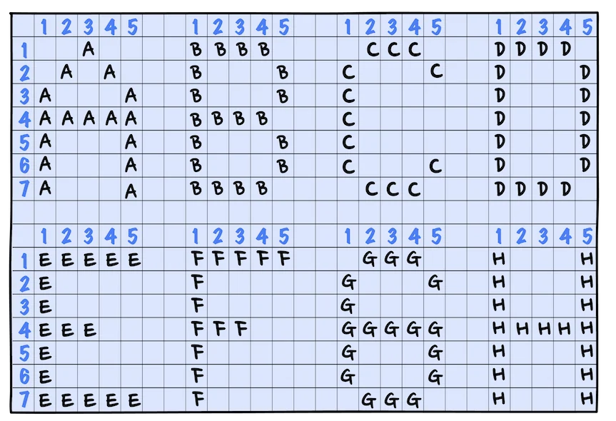

# Block Letters

[ASCII art](https://en.wikipedia.org/wiki/ASCII_art)
is a way of creating images using the individual characters from a keyboard.

For example,
the following is ASCII art of some letters from the English alphabet.

The letter F is made up of five characters in the first row,
one character in the second and third rows,
three characters in the fourth row,
and one character in the fifth,
sixth,
and seventh rows.

These characters look like the letter F.

In this project,
we will write a Python program that displays the initials of your name in block characters to get an introduction into the world of ASCII art.

Let's start coding!

_Code review available when you're done_

## Setting Up

### ✔️ Task 1

Let's start by wrtting two comments:

1. your full name
2. a fun fact about yourself

## Creating Art

### ✔️ Task 2

Now that we have our name down,
let's output our first initial!

Notice how each block letter is 7⨉5 and formed by the letter itself.

Try printing out the first character of your first or given name as a block character!

### ✔️ Task 4

Let's output your second initial too!

Add the first character of your last or family name to the `print()` call(s) you created earlier.
