# Introduction to Control Flow

Imagine waking up in the morning.

We wake up and think,
"Is it a weekday?"

If so,
we have to get up and get dressed,
and get ready for work or school.

If not,
we can sleep in a bit longer.

But,
alas,
it is a weekday,
so we are up and dressed,
and we go to look outside:

"What's the weather like?
Do I need an umbrella?"

---

These questions and decisions control the flow of our morning,
where each step and result are a product of the conditions of the day and our surroundings.

Our computer,
just like us,
goes through a similar flow every time it executes code.

A program will run (wake up) and start moving through its checklists -

Is this condition met?

Is that condition met?

Okay, let's execute this code and return that value.

---

This is the **control flow** of your program.

In Python,
our script will execute from the top down until there is nothing left to run.

It is our job to include gateway,
known as conditional statements,
to tell the computer when it should execute certain blocks of code.

If these conditions are met,
then run this function.

---

Over the course of this lesson,
we will learn how to build conditional statements using Boolean expressions and manage the control flow in our code.

