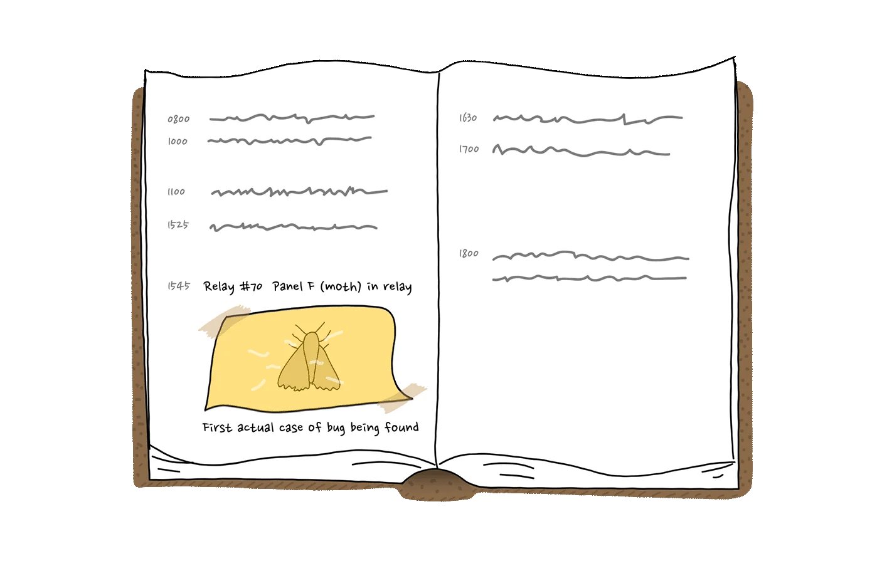

# Introduction to Bugs

["First actual case of a bug being found."](https://raw.githubusercontent.com/Codecademy/learn-python/main/2-control-flow/art/first-bug.jpg)

The story goes that on September $9^{th}$,
$1947$,
computer scientist [Grace Hopper](https://en.wikipedia.org/wiki/Grace_Hopper) found a moth in the Harvard Mark II computer's logbook and reported the world's first literal computer bug.

However,
the term "bug",
in the sense of a technical error,
dates back at least to 1878 and is associated with Thomas Edison.

---

Python refers to mistakes within a program as **errors** and will point to the location where an error occurred with a `^` character.

When programs throw errors that we did not expect to encounter,
we call those errors **bugs**.

Programmers call the process of updating the program so that it no longer produces bugs **debugging**.

---

During our programming journey,
we are destined to encounter innumerable red errors.

Some even say that 75% of development time is spent on debugging.

But what makes a programmer successful is not avoiding errors entirely -
it's knowing how to solve them,
and a good place to start is understanding what they are.

---

In Python,
there are many different ways of classifying errors,
but here are some common ones:

- `SyntaxError`:
  an error caused by not following the proper structure (syntax) of the language

- `NameError`:
  an error reported when the interpreter detects a variable that is unknown

- `TypeError`:
  an error thrown when an operation is applied to an object of an inappropriate type

In this mini-lesson,
we will be looking at these different types of errors,
and you'll get some practice debugging them one by one!
