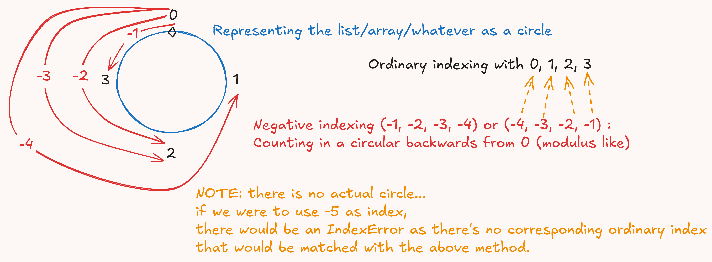

# Accessing List Elements: Negative Index

What if we want to select the last element of a list?

We can use the index `-1` to select the last item of a list,
even if we don't know how many elements it has.

Consider the following list with six elements:

```py
pancake_recipe = ["eggs", "flour", "butter", "milk", "sugar", "love"]

```

If we select the `-1` index,
we get the final element,
`"love"`

```py
print(pancake_recipe[-1])

```

This would output

```txt
love

```

This is equivalent to selecting the element with index `5`:

```py
print(pancake_recipe[5])

```

This would also output:

```txt
love

```

We can use negative indices besides just `-1` -
a negative index `-n` will retrieve the $n^{th}$ element from the _end_ of the list.

Here are the negative indices for all the items in our list:

| Element       | Index | Negative Inded |
| ------------- | ----- | -------------- |
| `"eggs"`      | `0`   | `-6`           |
| `"butter"`    | `1`   | `-5`           |
| `"milk"`      | `2`   | `-4`           |
| `"cucumbers"` | `3`   | `-3`           |
| `"juice"`     | `4`   | `-2`           |
| `"cereal"`    | `5`   | `-1`           |

---



---

## ✔️ Instructions

1. Create a variable called `last_element`.

   Assign the last element in `shopping_list` to the variable `last_element` using a negative index.

2. Now elect the element with index `5` and save it to the variable `index5_element`.

3. Use `print()` to display both `index5_element` and `last_element`.

   _Note_:
   _They are equal to_ `cereal`.
